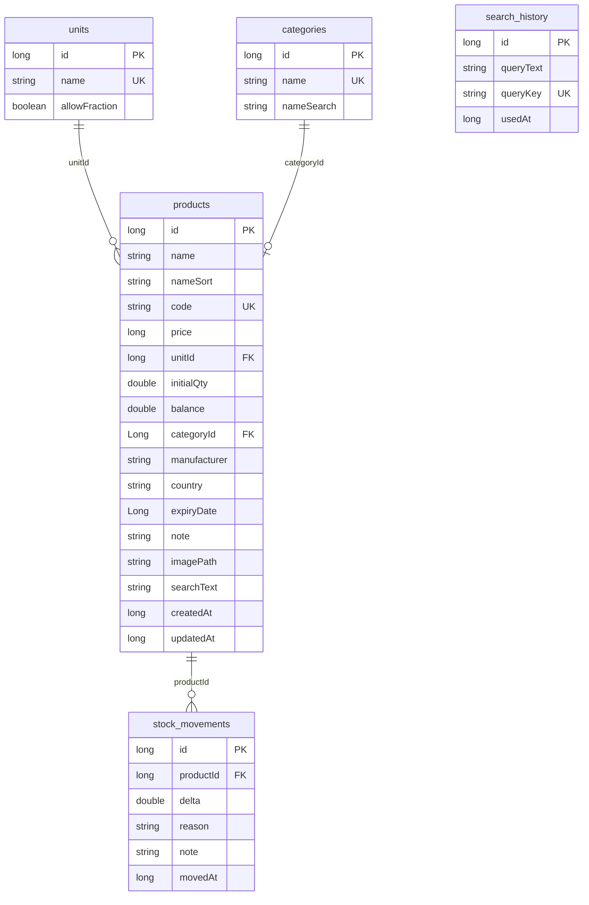

# Arxitektura Hujjati (ARCHITECTURE) — Magazin Xiva

## 1. Amaldagi Arxitektura Strukturasi
Loyiha **Layered Architecture** (Qatlamli arxitektura) hamda **Repository Pattern** asosida barpo etilgan. Loyiha kodi to'liq Java tilida yozilgan va quyidagi qatlamlardan iborat:

- **Presentation Layer (UI)**: Activity lar, Material Design 3 componentlari va Android ViewBinding.
- **ViewModel Layer**: `SearchViewModel` va LiveData orqali UI va data o'rtasidagi ma'lumotlar oqimi.
- **Domain / Business Layer (`Repo.java`)**: Biznes mantiq, transaksiya nazorati, lotin/kirill qidiruv mantiqi (`UzText`) va ma'lumotlarga yagona kirish nuqtasi.
- **Data Layer (Room Database)**: Room ORM (Entities, DAOs, SQLite database).
- **Utility & Support Layer**: Fon oqimlarini boshqarish (`AppExecutors`), rasm optimizatsiyasi (`ImageUtil`), CSV eksport/import (`CsvHelper`), xavfsizlik (`PinManager`, `AppLock`) va SharedPreferences (`AppPrefs`).

---

## 2. Texnologiyalar va Kutubxonalar

| Texnologiya / Kutubxona | Versiya | Vazifasi |
| :--- | :--- | :--- |
| **Java** | 11 | Asosiy dasturlash tili |
| **Android SDK** | Min: 24, Target/Compile: 34 | Platforma darajasi |
| **Android Gradle Plugin** | 9.3.3 | Bino qilish tizimi |
| **AndroidX AppCompat** | 1.7.0 | UI komponentlar bazasi |
| **Google Material Design** | 1.12.0 | Material 3 dizayn elementlari |
| **AndroidX Room** | 2.6.1 | Oflayn SQLite bazasi va ORM |
| **Lifecycle & LiveData** | 2.6.2 | Reaktiv ma'lumotlar oqimi va ViewModel |

---

## 3. Papkalar va Fayllar Tuzilishi

```
sardor.xiva.dukono/
├── DukonApp.java            # Application sinfi (Locale, Theme, Init)
├── data/
│   ├── Repo.java            # Yagona Repository (Room transaksiya va qidiruv)
│   └── db/                  # Room Entities va DAOs
│       ├── AppDatabase.java # Room Database bazasi (v1)
│       ├── Product.java / ProductDao.java
│       ├── Category.java / CategoryDao.java
│       ├── Unit.java / UnitDao.java
│       ├── StockMovement.java / StockMovementDao.java
│       ├── SearchHistory.java / SearchHistoryDao.java
│       └── ProductListItem.java / RefItem.java (DTOs)
├── ui/                      # ViewBinding bilan ishlovchi Activity va Adapterlar
│   ├── MainActivity.java    # Qidiruv va bosh ekran
│   ├── PinActivity.java     # Dinamik/Statik PIN kirish ekrani
│   ├── LockActivity.java    # Statik PIN sozlash ekrani
│   ├── ProductListActivity.java # Barcha tovarlar ro'yxati ekrani
│   ├── ProductDetailActivity.java # Tovar tafsilotlari ekrani
│   ├── ProductEditActivity.java   # Tovar yaratish va tahrirlash ekrani
│   ├── ReferenceActivity.java     # Birlik va Kategoriyalar ekrani
│   ├── SettingsActivity.java      # Sozlamalar ekrani
│   ├── ProductAdapter.java / RefAdapter.java # RecyclerView adapterlari
│   ├── SearchViewModel.java
│   └── Dialogs.java
└── util/                    # Yordamchi utilitlar
    ├── AppExecutors.java    # Fon oqimlari (SingleThread IO va Main Handler)
    ├── AppLock.java         # Activity Lifecycle monitoring (Avtoqulf)
    ├── AppPrefs.java        # SharedPreferences sozlamalari
    ├── CsvHelper.java       # CSV Export/Import (UTF-8 BOM bilan)
    ├── Fmt.java             # Pul/Sana/Miqdor formatlash va yaxlitlash
    ├── ImageUtil.java       # Rasmni ekran enining 70% da siqish va saqlash
    ├── Labels.java          # Qoldiq o'zgarish sabablari lug'ati
    ├── PinManager.java      # PBKDF2 Hashing va Dinamik PIN tekshiruvi
    ├── SimpleWatcher.java   # TextWatcher qisqartmasi
    ├── Ui.java              # Klaviatura va UI utilitlari
    └── UzText.java          # Lotin/Kirill neytralligi va saralash kaliti
```

---

## 4. Ma'lumotlar Bazasi Tuzilishi (Database Schema)



---

## 5. Arxitekturani Yaxshilash Bo'yicha Takliflar (Kelajak uchun)

> [!TIP]
> Ushbu takliflar amaldagi kodga darhol tatbiq etilmaydi, faqat kelajakda kod hajmi va murakkabligi oshganda ko'rib chiqiladi.

1. **CameraX Integratsiyasi**: Dasturning o'zida kamera rasmiga olish funksiyasi qo'shilganda Jetpack CameraX kutubxonasidan foydalanish.
2. **Room Migration**: Ma'lumotlar bazasi versiyasi oshirilganda (masalan v2 ga) foydalanuvchilar ma'lumotlari o'chib ketmasligi uchun aniq `Migration` strategiyasini belgilash.
3. **Dependency Injection (Hilt/Dagger)**: Kelajakda `Repo`, `AppDatabase` va Context obyektlarini boshqarish soddalashishi uchun Hilt integratsiyasini ko'rib chiqish.
